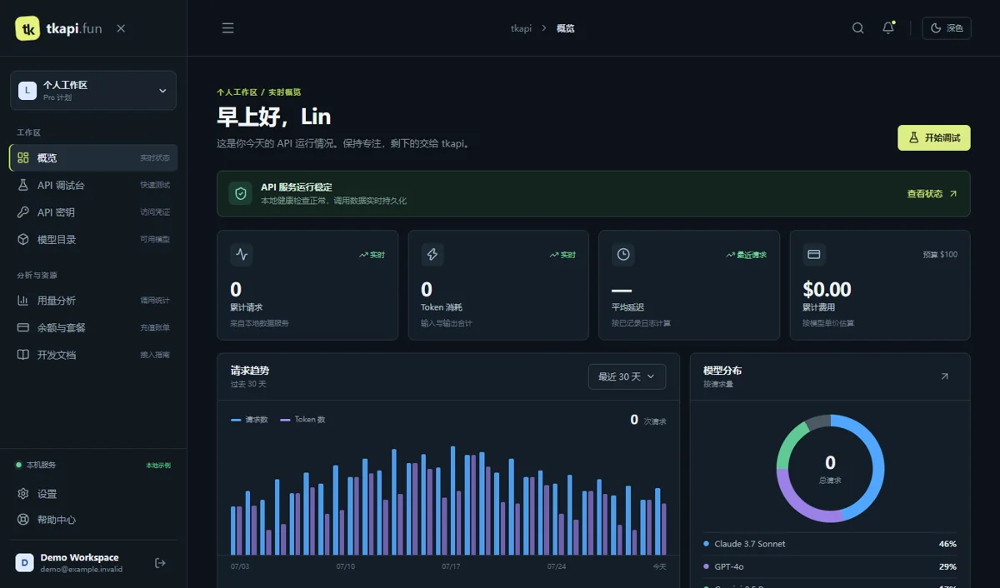
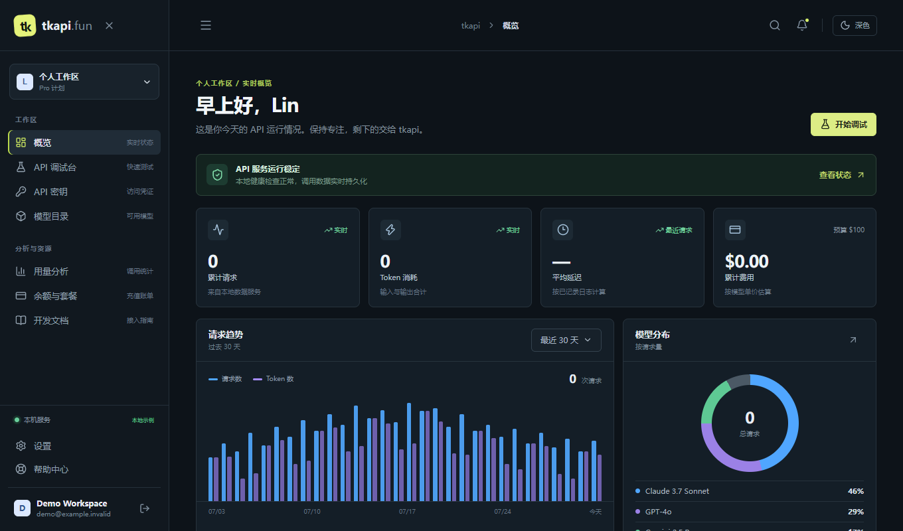
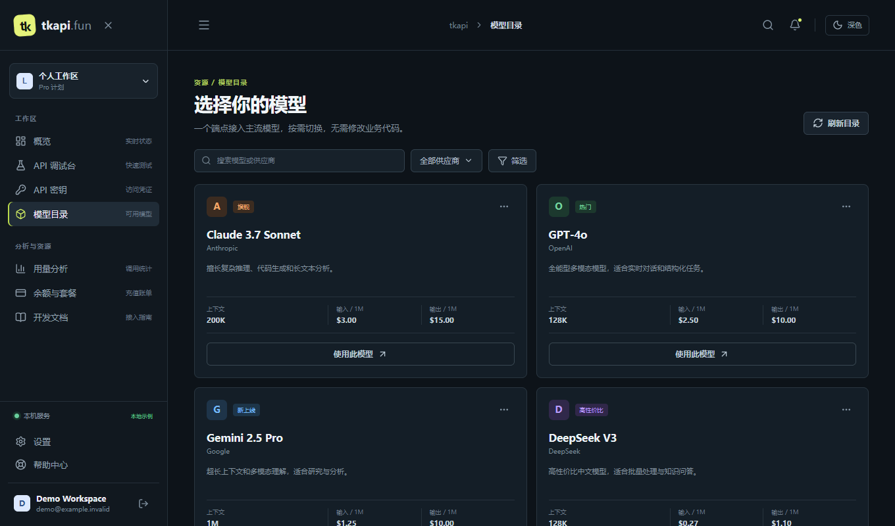

# Token API 本地控制台

查看模型目录、请求用量和日志，管理本机生成的密钥，并通过兼容接口调试。公开版从空账户与空请求记录启动。

## 实际界面巡览



上图由两张本次实际运行画面的截屏轮换组成，不是连续操作录像。

| 隔离账户的工作台 | 模型目录 |
| --- | --- |
|  |  |

## 可以做什么

- 注册临时本地账户，查看模型及设置
- 无上游配置时返回本地演示结果
- 仅监听回环地址，开发者自行配置可选的上游服务

## 本地运行

```sh
npm install
npm run build
npm start
```

## 实测与范围

隔离目录内注册虚构账号，回读模型目录；Vite 构建通过，未连接生产或调用付费模型。

默认打开 http://127.0.0.1:4174 。这是单用户开发台，不是经过生产审核的多租户计费服务；名录和界面价格是历史示例，不是现行报价。生产日志、个人密钥、账单均未发布。

[手机宽度实机截屏（390 px）](showcase/03-mobile.png) · [授权范围](LICENSE) · [来源与署名](NOTICE.md)
